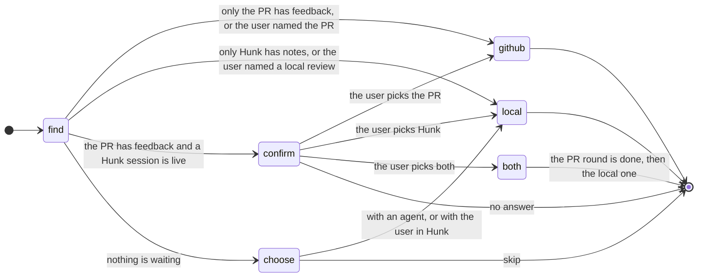

# PR review

One skill for review feedback, in two places:

- **GitHub.** Comments on a pull request.
- **Local.** Notes in a live Hunk session, or findings from an agent you asked, before a PR exists or between pushes.

This file decides which place is the target. The work itself is in the reference files, and you open one only when its state is reached.

#### find

- Enter: the skill starts.
- How:
  - The user's words pick the target when they name one:
    - "with devin", "with an agent", "do it local": `local`, with that reviewer.
    - "start a hunk session", "review with me": `local`, starting at its `session` state.
    - "follow my feedback", "answer my notes on hunk": `local`, and stay in its `follow` state.
    - "the PR", a PR number, or a PR link: `github`.
  - With no such words, run `python3 scripts/review_state.py --me LABEL` and take its `route`. It also prints what it found: the PR and its count of unhandled items, and the count of Hunk threads waiting on you.
    - `github`: the branch's pull request has unhandled items, and no Hunk session is live for this repo.
    - `local`: the PR has none, or there is no PR, and Hunk has threads waiting on you.
    - `confirm`: the PR has unhandled items, and a Hunk session is live. Either could be what the user means.
    - `choose`: nothing is waiting anywhere.
- Leave when: you know the route. Say which one and what the script found, in one line.

#### confirm

- Enter: more than one place could be the target.
- How:
  - Change nothing, post nothing, and fetch no findings to work on.
  - Ask the user once, with the harness's question tool when it has one. Give the counts from `find` with each option:
    - **The PR.** Handle the pull request's feedback.
    - **Hunk.** Handle the notes in the Hunk session.
    - **Both.** The PR first, then Hunk.
- Leave when: the user answered. No answer, as in a background run, means stop. Report what is waiting in each place.

#### both

- Enter: the user picked both.
- How: run `github` to its end, then `local`. A fix from the PR round can already settle a Hunk note, so check each note against the new code.
- Leave when: both are done.

#### choose

- Enter: nothing is waiting, and the user named no target.
- How: ask the user once, with the harness's question tool when it has one:
  - **Review with an agent (Recommended).** Another agent reviews the diff, and you fix what it finds.
  - **Review with me in Hunk.** Open a Hunk session, and answer the notes the user writes.
  - **Skip.** Do nothing.
- Leave when: the user picked. No answer means skip. Say so.

#### github

- Enter: the target is the pull request.
- How: open `references/github.md` and follow its states.
- Leave when: its last state is done.

#### local

- Enter: the target is local.
- How: open `references/local.md` and follow its states.
- Leave when: its last state is done.

## Reference files

- `references/finding.md`: how to handle one finding. Both paths use it.
- `references/github.md`: one review round on a pull request.
- `references/local.md`: a local review, with the user in Hunk or with an agent.
- `references/reviewer-brief.md`: the request sent to a reviewing agent.
- `references/round-github.md` and `references/round-local.md`: the round file shapes.

## Your label

Pick one author label for this harness, such as `claude-code` or `pi`, and use it on every note and in every script call. Add a suffix when two instances of the same harness work at once. The label is how the scripts tell your notes from everyone else's, so never change it during a review.

## Rules

- **Know the target before you act.** When the words and the script leave more than one, ask. A guess can post replies on the wrong review.
- **Say where you are.** Name the state you are in when you report, and any state you skipped and why.
- Do not dismiss a security or data-integrity finding without concrete proof it cannot happen.
- Never post a reply for a human reviewer on GitHub. Draft it for the user.
- Never delete or clear notes in Hunk. They are the user's and other agents' record.
- Local fixes stay in the working tree. Commit only when the user asks. On GitHub, running this skill is the ask to commit and push the round's fixes.
- Never commit a round file.
