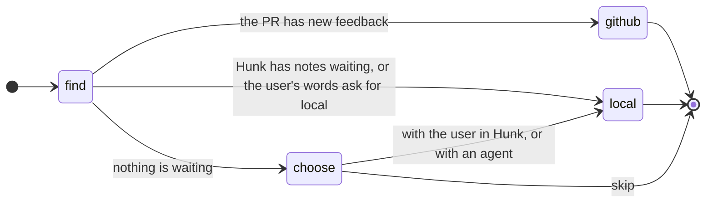

# PR review

One skill for review feedback, in two places:

- **GitHub.** Comments on a pull request. Steps in `references/github.md`.
- **Local.** Notes in a live Hunk session, or findings from an agent you asked, before a PR exists or between pushes. Steps in `references/local.md`.

The helper scripts are in `scripts/`. Run them with `python3`.

## Pick the path

#### find

- Enter: the skill starts.
- How:
  - The user's words pick the path when they name one:
    - "with devin", "with an agent", "do it local": `local`, with that reviewer.
    - "start a hunk session", "review with me": `local`, starting at its `session` state.
    - "follow my feedback", "answer my notes on hunk": `local`, and stay in its `follow` state.
    - "the PR", a PR number, or a PR link: `github`.
  - With no such words, run `scripts/review_state.py --me LABEL` and take its `route`:
    - `github`: the branch has a pull request with items nobody handled.
    - `local`: no such items, and this repo's Hunk session has threads waiting on you.
    - `choose`: nothing is waiting anywhere.
- Leave when: you know the path. Say which one and why in one line.

#### choose

- Enter: nothing is waiting, and the user named no path.
- How: ask the user once, with the harness's question tool when it has one. The options:
  - **Review with an agent (Recommended).** Another agent reviews the diff, and you fix what it finds.
  - **Review with me in Hunk.** Open a Hunk session, and answer the notes the user writes.
  - **Skip.** Do nothing.
- Leave when: the user picked. An absent user, as in a background run, means skip. Say so.

## Your label

Pick one author label for this harness, such as `claude-code` or `pi`, and use it on every note and in every script call. Add a suffix when two instances of the same harness work at once. The label is how the scripts tell your notes from everyone else's, so never change it during a review.

## Handle one finding

Both paths handle a finding the same way.

1. **Check the claim.** Read the code it points at and the whole thread. A reviewer can be wrong, so check the claim against the code before believing it.
2. **Pick a class.**
   - `fix`: the finding is right. Change the code.
   - `dismiss`: a false positive, an intentional choice, or out of scope. Needs concrete proof: a file and line, a test, or a doc.
   - `confirm`: the finding is right and needs no change, or it is a question with a clear answer. Answer it.
   - `clarify`: you cannot tell what it means. Ask the commenter one specific question.
   - `ask`: needs the user's call.
   - `noted`: nothing to act on, such as praise, a summary, or a CI pass report.
3. **Easy, or frame it.**
   - Easy means one obvious right answer, local, and low risk: a typo, a missing guard the code clearly needs, a dead import, a dismiss with hard proof. Do it now and verify it with the relevant test.
   - Frame it as `ask` when any of these hold:
     - more than one reasonable fix
     - a product, UX, or API tradeoff
     - it touches auth, permissions, payments, data migrations, or public interfaces
     - the fix reaches beyond the finding's scope
     - you disagree with a human
     - another agent pushes back on your earlier answer in the same thread. Do not argue a second time.
   - Framing means a short **Picture** (what the code does now, what the finding claims, what is at stake) and 2 to 4 **Options**, one marked `(Recommended)` with the reason. Then go on to the next finding. Do not block on it.
4. **Ask once, in one batch.** After the last finding, put every `ask` item to the user in one message, numbered, each with its options and the recommended one.
5. **Answer.** A fix answer cites what changed. A dismiss answer cites the proof. Keep answers short and plain, and run `unslop` on them.

## Rules

- Do not dismiss a security or data-integrity finding without concrete proof it cannot happen.
- Never post a reply for a human reviewer on GitHub. Draft it for the user.
- Never delete or clear notes in Hunk. They are the user's and other agents' record.
- Local fixes stay in the working tree. Commit only when the user asks. On GitHub, running this skill is the ask to commit and push the round's fixes.
- Never commit a round file.
