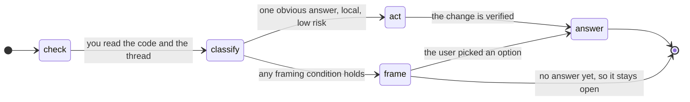

# Handle one finding

How to decide what to do with one review comment, note, or finding. Open it from the `handle` state of `references/github.md` and the `answer` state of `references/local.md`. Both paths handle a finding the same way.

#### check

- Enter: a finding is next.
- How: read the code it points at and the whole thread. A reviewer can be wrong, so check the claim against the code before believing it.
- Leave when: you know whether the claim holds, and can point at the evidence.

#### classify

- Enter: the claim is checked.
- How: pick one class.
  - `fix`: the finding is right. Change the code.
  - `dismiss`: a false positive, an intentional choice, or out of scope. Needs concrete proof: a file and line, a test, or a doc.
  - `confirm`: the finding is right and needs no change, or it is a question with a clear answer. Answer it.
  - `clarify`: you cannot tell what it means. Ask the commenter one specific question.
  - `ask`: needs the user's call. See `frame`.
  - `noted`: nothing to act on, such as praise, a summary, or a CI pass report.
- Leave when: the finding has a class.

#### act

- Enter: the finding is easy. Easy means one obvious right answer, local, and low risk: a typo, a missing guard the code clearly needs, a dead import, a dismiss with hard proof.
- How: do it now, and verify it with the relevant test.
- Leave when: the change is made and verified, or the proof is in hand.

#### frame

- Enter: any of these hold.
  - more than one reasonable fix
  - a product, UX, or API tradeoff
  - it touches auth, permissions, payments, data migrations, or public interfaces
  - the fix reaches beyond the finding's scope
  - you disagree with a human
  - another agent pushes back on your earlier answer in the same thread. Do not argue a second time.
- How:
  - Write a short **Picture**: what the code does now, what the finding claims, and what is at stake.
  - Write 2 to 4 **Options**, one marked `(Recommended)` with the reason.
  - Go on to the next finding. Do not block on this one.
  - After the last finding, put every framed item to the user in one message, numbered, each with its options and the recommended one.
- Leave when: the user picked, and you applied and verified it. An item with no answer stays open, and nothing is posted for it.

#### answer

- Enter: the finding is settled.
- How:
  - A fix answer cites what changed. A dismiss answer cites the proof.
  - Keep it short and plain, and run `unslop` on it.
  - Where it goes is the path's business: see the `answer` state of `references/github.md` or `references/local.md`.
- Leave when: the answer is written.
