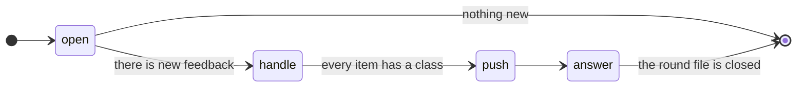

# Review on GitHub

One review round of a pull request. Open it when the path is `github`. A PR gets reviewed several times as the code changes, so each run is a new numbered round with its own file. The round file is the record: every consideration and decision goes there before anything is posted.

The script is `scripts/pr_threads.py`. `PR` defaults to the pull request of the current branch.

#### open

- Enter: the path is `github`.
- How:
  - Run `pr_threads.py open-round [PR]`. It prints the round number, the file path, the head commit, and the earlier round files.
  - Read every earlier round file, so a comment that repeats an earlier one reuses that decision.
  - Create the round file with the header from `references/round-github.md`. It lives at `<main worktree>/.pr-feedback/pr-<N>/round-<NN>.md`, which the script keeps out of git.
  - Run `pr_threads.py fetch [PR]`. It returns unresolved threads, review bodies, and top-level comments that no earlier round recorded, and skips threads where the PR author replied last. Each item has `agent: true|false`.
- Leave when: you have the items. Nothing new? Write "No new feedback" in the round file and stop.

#### handle

- Enter: there are items.
- How:
  - Collect every item first, from every reviewer, before you change anything. Two that touch the same code get one fix. One that contradicts another is an `ask`.
  - Take each item through `references/finding.md`. `outdated: true` means the line moved or changed, so read the current code.
  - Write each item's consideration into the round file as you finish it, not at the end. Keep the `<!-- ids: ... -->` line under each item exactly as `fetch` gave it. Those ids are how later rounds know what is handled.
  - When the user answers the `ask` batch, write each answer into that item's **Decision**, then apply it and verify.
- Leave when: every item has a class, and every easy one is done. An item the user has not answered stays `waiting on you`, and nothing is posted for it.

#### push

- Enter: the round changed code.
- How:
  - Run the project's checks.
  - One commit for the round, in Conventional Commits form, such as `fix: address review round 2`. Not one commit per comment.
  - One push. Never force-push.
- Leave when: the push went out. No code changes? Skip this state.

#### answer

- Enter: the fixes are pushed, or there were none.
- How:
  - Write every item's **Answer** into the round file first. A fix answer cites the commit: `Fixed in abc1234: ...`.
  - An agent's thread (`agent: true`): post the answer with `pr_threads.py reply THREAD_ID BODY_FILE`, then `pr_threads.py resolve THREAD_ID`.
  - An agent's top-level comment or review body cannot be resolved. Answer those together in one `gh pr comment <N> --body-file <file>`, and only when something in them was actionable.
  - A human's item (`agent: false`): post nothing. The Answer in the round file is a draft for the user to post and resolve.
  - Record what happened in each item's **Action**: `replied + resolved`, `drafted for you`, `waiting on you`, or `no reply needed`.
  - Fill the Summary and the "For you" list.
- Leave when: you reported the round file's path, the drafts to post, and the open questions.

## Rules

- Never resolve a thread whose Decision is still open.
- An agent that posts through a personal account counts as an agent when its login is in `PR_FEEDBACK_AGENTS`, a comma-separated list.
