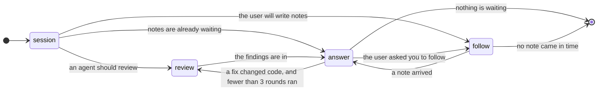

# Review locally

Review on this machine, before a PR exists or between pushes. Open it when the path is `local`. The reviewer is the user, writing notes in Hunk, or another agent you ask. Either way you fix what is found and answer each finding.

The script is `scripts/hunk_notes.py`. `SELECTOR` is `--repo <path>` or a Hunk session id, and defaults to `--repo .`.



#### session

- Enter: the path is `local`.
- How:
  - Run `hunk session list --json`. A session for this repo is live? Use it.
  - No session, and the user asked for one or chose to review with you: start it for them.
    - In Rex or Ghostty, open a pane beside the one this conversation is in, in the same tab, and run `hunk diff <base> --agent-notes` there. Use the `rex` skill in Rex and the `use-ghostty` skill in Ghostty.
    - `<base>` is the branch this work will merge into. That diff holds the commits and the uncommitted work.
    - In any other terminal, ask the user to run that command.
    - Wait until `hunk session list --json` shows it. Tell the user which pane it is in.
  - No session, and an agent reviews: go on without Hunk. The findings stay in a file, and your answers go in the report. Never start Hunk when nobody asked for it.
  - Never run `hunk diff` in your own shell. It is a full-screen app for the user.
- Leave when: you know whether Hunk is live, and who reviews.

#### review

- Enter: an agent should review this round.
- How:
  - Pick the reviewer.
    - The user named one: use it.
    - Otherwise Devin, when it is available: `command -v devin` prints a path, `devin auth status` says logged in, and the `use-devin` skill is installed. A different model is not anchored on your reading of the code.
    - Otherwise a fresh subagent from your harness's subagent tool.
    - Neither? Say so, and offer the review with the user in Hunk.
  - Write the brief to a file outside the repo, from `references/reviewer-brief.md`. Give the reviewer the diff and no conclusions of yours. From round 2 on, add the earlier findings with your answers.
  - Send it, and save the reply to a file outside the repo.
    - Devin: `python3 <use-devin>/scripts/devin_review.py --brief <brief> > <findings>`, in the background, where `<use-devin>` is that skill's folder. The script keeps one Devin session per branch, so each round lands in the session that saw the last one. Never call `devin` yourself for a review.
    - A subagent: pass it the brief, and write its reply to the findings file.
  - Read the whole diff yourself while the reviewer works. Do not wait idle.
  - Hunk is live? Run `hunk_notes.py load <findings> --author <reviewer> [SELECTOR]`. The findings become notes the user can read and answer. `<reviewer>` is a label such as `devin` or `reviewer`, never your own.
- Leave when: the findings are in Hunk, or in the file when Hunk is not live. A reply with no findings ends the review: go to `answer` with nothing to do.

#### answer

- Enter: findings or notes are waiting.
- How:
  - With Hunk: run `hunk_notes.py fetch --me LABEL [SELECTOR]`. It returns the threads whose last note is not yours, grouped by root. `from` is `human` or `agent`, and `reply_to` is the note to reply to.
  - Without Hunk: read the findings file.
  - Take each one through `references/finding.md`.
  - With Hunk, reply to every thread, `noted` ones too, so it stops waiting on you. Post all replies as one batch:

    ```bash
    printf '%s' "$BATCH_JSON" | hunk session comment apply SELECTOR --stdin --focus --json
    ```

    - The batch is `{"comments":[{"replyTo":"<note id>","summary":"...","rationale":"...","author":"LABEL"}]}`. Hunk checks the whole batch before it writes any of it.
    - Start each summary with its tag: `[fixed]`, `[dismissed]`, `[confirmed]`, `[noted]`, `[clarify]`, or `[ask]`. A fix cites the file and line it changed.
    - `rationale` shows under the summary. Put the Picture and Options of an `ask` there, the recommended one first.
    - Agent notes are hidden in Hunk until the user presses `a`. `--focus` lands them on your first reply and turns the notes on.
  - Without Hunk, keep each finding's answer in a file outside the repo. The next round's brief carries them.
  - Report in chat: a count per tag, the files you changed, and the open `ask` items, numbered, each with its recommended option. No recap of every thread.
  - Write a round file only for a big change. See Round files.
- Leave when: every finding has an answer.
  - Ask the same reviewer again when a fix changed code and fewer than 3 rounds ran. The reviewer sees your answers and can push back.
  - Stop when a round finds nothing new, or after round 3. Then report what is still open.

#### follow

- Enter: the user will write notes in Hunk, or asked you to follow their feedback.
- How:
  - Run `hunk_notes.py wait --me LABEL [--timeout S] [SELECTOR]`. It returns as soon as a thread waits on you, or an empty list after `S` seconds (900 when not given).
  - An answer the user gives in chat: apply it, and reply in the thread.
- Leave when: a note arrived, or the wait ended with none. On an empty wait, say you stopped following and how to start again.

## Round files

Only for a run with a big change. A change is big when any of these hold:

- the user settled an `ask` item that changes design or behavior
- a fix changes a public interface, a data shape, or behavior a user would notice
- a fix spans several files or reaches beyond the finding's lines
- the user asks for the record

Run `hunk_notes.py open-round [SELECTOR]`. It prints the next round file path, `<main worktree>/.pr-feedback/local-<branch>/round-<NN>.md`, and the earlier rounds. Write it with `references/round-local.md`, covering only the big items.

## Hunk

- `hunk-review` is the full guide to the Hunk CLI. Load it only for something not written here, such as navigate or highlight, and at most once per session.
- "No active Hunk sessions" while Hunk is visibly running can mean the agent's sandbox blocks localhost. "Multiple active sessions match" means pass the session id from `hunk session list`.
- Hunk has no resolve state. A thread counts as handled once your reply is its last note.
- Do not reload the session to show fixes unless you know the command it was started with. Tell the user the fixes are in.
